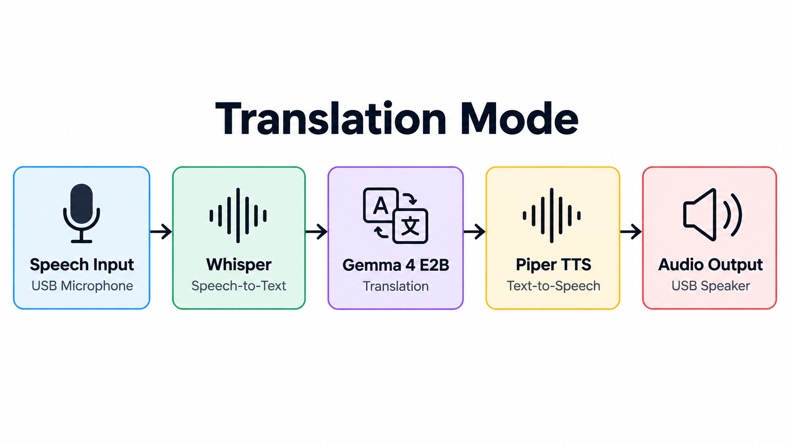
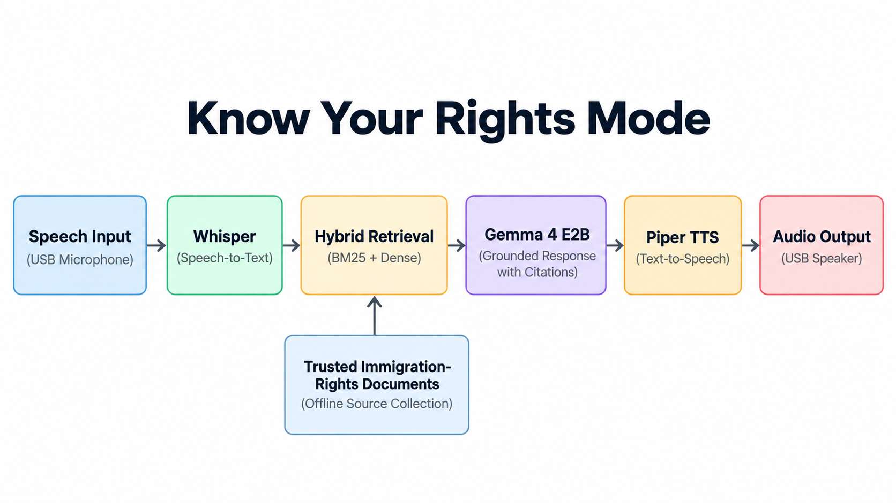

# Derecho architecture

Derecho runs on a Raspberry Pi. The root launcher starts or reuses the local
services and opens the touchscreen in Firefox. See [Pi setup](pi-setup.md) for
installation paths and logs.

## Translation today



```text
React touchscreen → FastAPI → arecord → input WAV
On release: Whisper → transcript → Gemma → translation → Piper → aplay
FastAPI returns the transcript and translation after playback completes.
```

- `frontend/src/App.jsx` owns the touchscreen flow. `i18n.mjs` holds interface
  strings independently of the selected speech languages.
- `backend/derecho/api.py` exposes recording, language, Replay, and volume routes.
  The kiosk connects to the API on `127.0.0.1:8000`.
- `backend/derecho/integration/translator_pipeline.py` coordinates Whisper,
  Gemma, and Piper. The user selects the source and target languages; the normal
  launcher processes speech after release.
- `backend/derecho/audio/devices.py` discovers USB capture and playback devices.
  Replay uses the latest generated WAV without running inference again.

See the [walkthrough](translation-walkthrough.md) for a full turn and
[audio setup](translation-audio.md) for device selection and voice models.
[Performance experiments](translation-performance.md) describe optional paths
that are disabled by the normal launcher.

## Know Your Rights

PDF ingestion and BM25 keyword retrieval exist in
`backend/derecho/retrieval/`. Source PDFs, metadata, and searchable chunks
are under `data/legal_sources/`.

The touchscreen entry is still a placeholder. The next planned flow is an
English or Spanish text question, retrieval from the local corpus, and an
answer citing the source and page. It should decline to answer when the
available passages do not support an answer. Voice and hybrid retrieval are
later work.

**Planned voice workflow.** The diagram shows a later design that combines
BM25 and dense retrieval, generates cited answers, and reads them aloud.



## Local data

Normal inference does not require internet. Done clears the on-screen
conversation; the latest input and output WAVs remain on disk.
